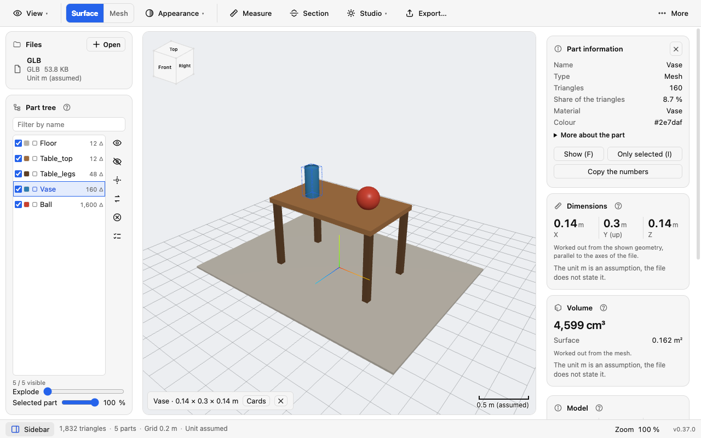
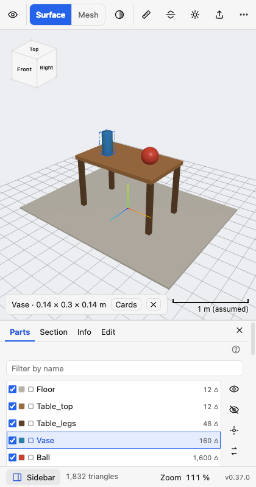
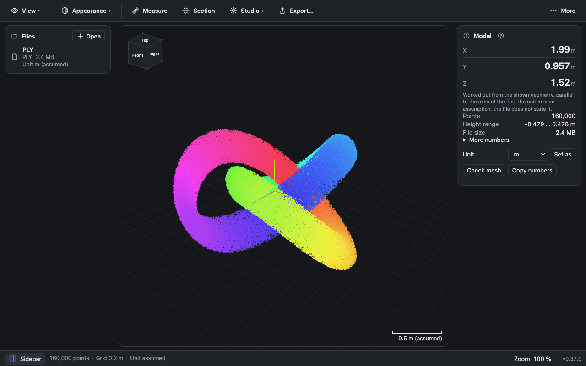
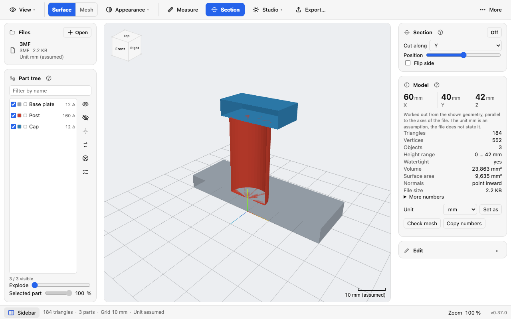

# 3D Model Viewer for Orca

Open a 3D model in Orca's editor tab and look at it: orbit, zoom, pan, surface or mesh, textures, and per-part colors and
visibility. It runs entirely inside Orca, **offline, with no permissions**.



## Formats

| Format | Extensions | Notes |
| --- | --- | --- |
| glTF binary | `.glb` | Meshes, materials, textures, vertex colors, points and lines. Meters, +Y up (glTF specification). **Draco** compression (`KHR_draco_mesh_compression`) and meshopt compression are decoded; KTX2/Basis textures are not (see *glTF in more forms*). |
| glTF text | `.gltf` | Opens like a GLB. Buffers and pictures as `data:` URIs open from Orca directly; **separate files** (`.bin`, pictures) are read when the `.gltf` is dropped or chosen together with them, or when a **folder** is dropped or chosen (*Choose folder …*). |
| PLY | `.ply` | Binary and ASCII. Triangle meshes and **point clouds** (point size slider). Vertex colors. 3D Gaussian splat files (as the training tools write them) show as **splats**, and as colored points on request. |
| Gaussian splats | `.splat`, `.spz` | Splat scenes, shown as splats (see *Gaussian splats* below). `.ksplat` is not supported (no test file to check it against). |
| OBJ | `.obj` | Geometry and vertex colors. `.mtl` material files and texture images are not read (a plugin only sees the file it opens). |
| STL | `.stl` | Binary and ASCII. STL stores no unit, so sizes are shown as "units (usually mm)". Z up. |
| 3MF | `.3mf` | Several objects, each listed as a part. Slicer projects (Bambu Studio, Orca Slicer, PrusaSlicer) with meshes in separate `3D/Objects/*.model` files are read completely: components are resolved per file, transforms applied, object and part names and filament colors taken from the slicer's configuration; unpacked size is limited to 0.9 GB. The unit is read from the file. Extensions that cannot be drawn (beam lattice, slices, parts in separate `.model` files, slicer metadata) are listed in the details, so a file is never shown as if it were complete. Z up. |
| FBX, PCD, XYZ, G-code | `.fbx`, `.pcd`, `.xyz`, `.gcode` | See *More formats (0.10.0)* below. |
| USDZ | `.usdz` | Shows a notice only. USDZ is meant for Apple AR Quick Look (select it in Finder and press Space). |

## What you can do

- **Look around**: drag to orbit, right-drag or Shift-drag to pan, scroll to zoom (towards the cursor). **View** (or `R`)
  resets the camera.
- **Appearance**: **Surface | Mesh** (`W`: one switch with both words, the active one blue), textures on or off (`T`; only for models with textures, and only in the Original and Flat looks), floor grid (`G`), axes at the
  origin, bounding box, **mesh over the surface** (Appearance > Advanced), backfaces on or off.
- **Parts**: a file with several meshes, materials or objects lists each one with a checkbox. **Color by part** gives every
  part its own color; click a part in the view or in the list to select it (a dashed blue box frames it); **Ctrl or Cmd click** adds or removes a part, **Shift click** in the list selects a range, **Esc** clears; without a key (trackpad, touch) the **Select several** button (a symbol beside the part list) makes every click add a part (the hint on selecting parts, behind the "?" of the *Part tree* card, says all this in a line); double-click a
  row to show only that part; **All / None / Invert** change all at once. The **part card** (and a chip in the view) gives size, triangles and share of the model; *More about the part* adds surface, volume, the mesh check, material, position and instance; two parts also give the distance between them.
- **View menu**: isometric, front, back, left, right, top, bottom, hero (select or keys `1` to `8`) and *Show all* (`R`). Every view fits the whole model, from wherever the camera is; there is no separate *View* button.
- **Section** (toolbar button; its card opens while a plane is on, below 1200 px it is a tab): cut the model with a plane along the file's own X, Y or Z, move it with a slider, flip the side. For G-code it is called **Layers**: *Up to layer n / N* and *Show travel moves*.
- **Measure** (`M`): distance, angle, circle diameter or edge length (a bar in the view with the ways to measure, and **Parts** from two parts): see *Looking closer*. Edge length measures a model edge, where the surface bends, a straight edge end to end; only when none is found (a mesh over a million triangles, a smooth part with no 20-degree edge near the click) a triangle edge stands in and the text says so.
- **Appearance** (menu): shading and opacity: original colors, solid gray, normals, X-ray, matcap, flat or vertex colors; opacity slider for a see-through look.
- **Export…** opens a dialog for an image, a film or a 3D file (see below). *Save image…* and *Film…* in the Studio menu open the same dialog.
- **Animation**: glTF animations play and pause, with a clip choice.
- **Filter**: a search box narrows long part lists by name.
- **Texture size**: show huge textures smaller (max 4096, 2048 or 1024 px) to save GPU memory; the details show the texture memory.


- **Layout**: a toolbar on top with a symbol in front of every word (*View*, *Surface | Mesh* with *Appearance*, *Measure*, *Section*, *Studio*, *Export…* and *More*; from 1300 px also *Open*, *Diagonal*, *Front*; the words give way to the symbols when the window is narrow) and a status bar at the bottom with the sidebar button and the numbers of the view (triangles or points, parts, grid step, zoom), an orientation cube and a scale bar in the view; from 1200 px the sidebar is two columns of cards around the view (*Files* and the *Part tree* on the left; *Section* while a plane is on, *Measurements*, the part cards *Part information*, *Dimensions*, *Volume*, *Model* and a folded *Edit* on the right); below 1200 px it is one column with the tabs *Parts*, *Section*, *Info* and *Edit* (and *Measurements n* from the first measurement on; a file starts on *Parts* or *Info*, never on an empty tab). Drag the panel's edge to resize it (arrow keys too, double-click resets), fold sections one by one, close it with the button or `P`; all of it is remembered. In a narrow tab or the sidebar (under 520 px) the panel is a sheet under the view and what does not fit on the toolbar even as a symbol (*Studio*, *Export…*, *Section*) is in the **More** menu, which has three groups: files · shortcuts · reset.
- **Info** (the *Model* card; the *Info* tab below 1200 px): file size, triangles, vertices or points, size along the file's own X, Y and Z, height range, grid step, unit,
  texture size and memory (only for models that have textures), and load time.
- **Orientation**: files do not always say which axis is up. Choose +Y (glTF), −Y (OpenCV / COLMAP: y points down) or +Z
  (CAD, 3D printing); the choice is remembered per format.
- **Big files**: the view only redraws when something changes, so an idle viewer uses no GPU. Heavy models are drawn at a lower
  resolution while you orbit. Above about 1.5 million triangles or 4 million points the details show a hint that orbiting may
  stutter. Measured (Chrome on Apple Silicon, 1280 × 800): a 1.85 million triangle mesh draws in 3.9 ms per frame, a 2.17
  million triangle textured mesh in 3.2 ms, 8.6 million points in 10.8 ms.
- **Live**: when the file changes on disk (for example a program writes a new version), the view updates and the camera
  stays where it was.
- The interface is in English and German (it follows Orca's language).

|  |  |
| --- | --- |
|  |  |

## Open without a file: start page, drop, picker

You do not need a file in the workspace. Three ways to get an empty viewer that takes a model:

- **Sidebar panel "3D"** (right sidebar): always available, shows the start page.
- **New file → "3D Viewer (drop a model)"** (the + menu of the tab bar or the command palette): opens a tab with the start page.
- Any open viewer tab: **Open** in the toolbar (from 1300 px) or in the *Files* card, or just drop a file onto the view.

On the start page drag a model in from Finder or any folder, or press **Choose file…**. Files one after another replace the view.
Dropped files are read by the browser's File API, so Orca's 50 MB limit for files it hands to an editor does **not** apply:
measured in Chrome, a dropped 98 MB GLB (2.2 million triangles) opened in 0.6 s, a 204 MB PLY in 2.0 s, a 79 MB OBJ in 1.2 s,
using about 200 to 300 MB of JavaScript heap on top of the file. Above 150 MB the page asks before loading, above 1.5 GB it refuses.
Several files at once: the first supported one opens, the rest are reported as ignored. A format that is not supported gets a clear message
(STEP files point to the companion plugin).

**For an agent:** every time a model is shown the viewer logs one line, `model-viewer-3d-state {...json...}` (file name when it was
dropped or picked, format, bytes, triangles, vertices, points, parts, size along the file's own axes, unit, load time). Read it with
`orca plugin logs local.model-viewer-3d --json` (the key is `<publisher>.model-viewer-3d` for an installed plugin). The picture of the
panel is available with `orca plugin shot <key> --panel viewer`. Limits: the plugin has no permissions, so it cannot write a file or
learn a path (Orca gives frames only the file name of a dropped file, never its location); warnings and errors are the only console
levels `orca plugin logs` keeps, so the state line is a `console.warn`.

- **The last file comes back.** Orca builds a panel's frame anew when the panel is shown again (the right sidebar was closed and opened, another panel was in front), and an editor tab when it is shown again, so what the page held would be gone. The last file you **dropped, chose or pasted** is therefore kept in the plugin's own browser storage (IndexedDB of its frame, this computer only, up to 200 MiB) and opened again when the panel (or the start file) starts without a document, with the camera and the display switches. The next file replaces it; **Close file…** (it asks first) deletes it; a file larger than 200 MiB is not kept (the panel says so). A file Orca opens in an editor tab is never replaced by it. The agent can see frame starts as `model-viewer-3d-boot` lines in `orca plugin logs`.

## Export

**Export…** in the toolbar (or `E`) opens the **Export** dialog: choose **Image**, **Film** or **3D file** (and the format), press **Create copy**,
then **Save as …**: Orca's Save dialog asks where to put it. **The original file is never changed**, and nothing is written without
that click. (It is two steps because the Save dialog needs a fresh click and a large file can take longer to build than a click
stays fresh; it also lets the panel show the size first.)

| Format | What the copy has | What it does not keep |
| --- | --- | --- |
| **GLB** | meshes, materials, textures, glTF animations, point clouds; Y up | Draco and meshopt compression (the copy is written without it), unknown glTF extensions and extras; KTX2 textures cannot be read here, so they are missing; the file can get larger |
| **STL** | all triangles as one binary solid; Z up | colors, part names, textures, units, point clouds |
| **OBJ** | one object per part; colors as vertex colors (`v x y z r g b`) | a material file, textures |
| **PLY** | meshes and point clouds with vertex colors (binary) | part names, textures, other properties such as splat data |
| **3MF** | geometry, part names, **one color per part**, the unit (core specification) | slicer data (painted colors, profiles, plates, height ranges), vertex colors, textures, point clouds |
| **GLB, compressed** | the same as GLB, made smaller to a target size (see Tools) | exact precision (positions, normals and colors keep fewer bits), original texture encoding |
| **PNG** | the current view; a long edge of 1920 or 3840 px; a transparent background draws only the model (no grid, axes or box) | |
| **WebM** | one turn around the model (4, 8 or 15 s), recorded from the view as it is | |

Options: *Only visible parts* leaves out what you hid in the parts list; *Up in the copy* turns the model so that +Y (glTF), +Z
(CAD, printing) or the file's own axes are up (the default is the format's convention: Y for GLB, Z for STL and 3MF, unchanged
for OBJ and PLY). The panel names what each format loses before you save, and shows the **size of the copy against Orca's limits**:
under 50 MiB Orca can open the copy in a tab; between 50 and 64 MiB it can save it but not open it in a tab (drop it into the viewer
instead); above 64 MiB the Save dialog refuses it, so make the model smaller first (for glTF: `gltfpack -cc`).
A 3MF that came from a slicer is never written back: the copy is a plain 3MF without the slicer data.

## Tools: change the working copy

The **Edit** card of the sidebar (the **Edit** tab below 1200 px) changes the model that is on screen, the *working copy*; the file on disk is never touched and
nothing is saved by a tool. **Export** then writes the working copy, so Edit and export work together. **Back to the file**
undoes everything. After a tool the panel shows the size and triangle numbers before and after (and, for the ones that change the
shape, two small pictures). A 3MF that is written afresh contains no slicer data (painted colors, profiles, plates); 3MF files are only read.

- **Compress under a size** (format **GLB, compressed** in the export section): the main way to make a file under Orca's 50 MiB. Choose the target size (default 45 MiB), the largest texture size and the precision. Vertices are merged and reordered, positions, normals and colors are stored with fewer bits, the data is packed with meshopt (`EXT_meshopt_compression`, which this viewer and Orca open), and textures are re-encoded smaller (JPEG, PNG where there is transparency) until the file fits. The panel reports *target reached* or *not reachable* with suggestions. It runs in a worker with a progress display and a Cancel button, so the page stays usable. Point clouds are packed the same way; **Remove points if the target needs it** thins them (with a warning; a Gaussian splat file keeps only its colored points, not the splat shapes).
- **Transform**: **unit** (convert keeps the real size, *Set as* only says what the numbers mean for a file without a unit), **origin** (center, center on floor, put on floor, corner at 0), **scale**, **rotate** in 90° steps about X, Y or Z, **mirror**, and **make "Up is" part of the model**.
- **Parts**: remove the hidden parts, remove the selected part (click it in the view), merge the visible parts without textures into one mesh.
- **Mesh**: **decimate** to a share of the triangles (detail: careful, normal, reach the target; optionally keep borders) with before and after pictures, and **check mesh** (holes, non-manifold edges, inconsistent orientation, degenerate triangles, separate pieces, volume of a closed mesh). The check only counts; it does not repair.

Measured with synthetic test files (`dev/make_big.mjs`, `dev/measure-compress.mjs`; Chrome on Apple Silicon, whole browser memory): a 221 MB GLB (3.2 million triangles, three 4096 × 4096 PNG textures) became **8.8 MB** in 6.6 s (peak 2.5 GB, 2.0 GB of it for loading the model) and opens again in 0.2 s; a 218 MB splat-like PLY with 3.2 million points became **17.7 MiB** in 1.8 s (thinned to 12 MiB: 2.8 million points, 6.3 s). Decimating the 3.2 million triangles to 30 % took 3.0 s; the mesh check took 1.2 s.

## Looking closer (0.7.0)

- **Shading**: original, solid gray, normals, **X-ray** (see-through), **matcap**, **flat** (facets) and **vertex colors**. Opacity, section and backfaces work with all of them.
- **Measure** has four ways (the *Measure* button or `M`): distance between two points, **angle** at the second of three points, **circle diameter** from three points on the rim of a round hole or disc, and **edge length** (click near an edge). Results are in the file's own axes and unit.
- **Measure+** (0.24.0 / STEP 0.22.0): measurements stay. Each has a label on its line (value, name), the *Measurements* tab (it appears with the first one) lists them (rename, colour, hide, delete, change a point by dragging its marker or *Set again*), **Chain** measures several points in a row (pieces, sum, area when closed), two ticked measurements are compared (difference, ratio), *Copy as text* / *Copy as CSV*, the labels are drawn into saved pictures, and *Close file* names them. Tests: `shared-measure-store.test.mjs` (known cube, 3-4-5 triangle, 3 × 4 rectangle) and `dev/e2e-measure.mjs`.
- **Show the selected part**: `F` zooms to the selected part (or shows everything), a double-click on a part selects it and zooms to it; the *View* menu has *Show all* (`R`) and *Show the selected part* (`F`); `I` shows only the selected part, `Shift+I` shows all again.
- **Explode** pulls the parts of a scene apart (a view only: an exported copy always has the parts in place); **Selected part** makes one part see-through.
- **Parts list**: nested scene groups are indented, and the filter (from 4 parts) searches the name, the **material name** and the **color** (`#rrggbb`).
- **Details**: *Watertight*, *Volume* and *Surface area* appear a moment after a model (up to 500,000 triangles) has loaded; **Copy numbers** puts the rows on the clipboard as text (no model data).
- **Loading**: a dropped file over 4 MB is read in pieces; the message shows how far it is and **Cancel** stops reading. Peak memory measured with 200 MB synthetic files (Chrome on Apple Silicon, whole browser): a 221 MB GLB 1.9 GB, a 218 MB point-cloud PLY 1.8 GB, load 2 to 3 s.
- **3MF from Bambu Studio and Orca Slicer**: triangles painted with a filament (`paint_color`, painted as a whole) show in that filament's color; finer paint (a triangle split into smaller areas) is counted in a note and keeps the part's color.
- **Start page**: explains the formats and offers generated examples (table scene, torus, point cloud).

## More formats (0.10.0)

- **FBX** (`.fbx`, ASCII and binary 7.x) through three.js' loader, loaded only for FBX files: meshes, materials, embedded textures, animation. The loader ignores the unit and the up axis; the viewer reads them from the file's global settings (unit `cm` when the file does not say) and sets *Up is* accordingly. Pictures that the file only names (separate files) cannot be fetched by a plugin and are left out; embedded pictures are the loader's job and were **not tested** (no sample has one). Tested with generated ASCII and binary files only, not with files from Autodesk, Blender or Maya. An X-up file (rare) is shown Y-up; choose *Up is* by hand.
- **PCD** (`.pcd`, ASCII and binary; three.js' loader also has `binary_compressed`, not tested here) and **XYZ** (`.xyz`, text: `x y z` or `x y z r g b`, 0–255 or 0–1, comments and a header line are skipped): point clouds with colors.
- **G-code** (`.gcode`): the toolpath as lines, colored by height (blue at the bed, red at the top), with **arcs** (`G2`/`G3` with `I`/`J` or `R`, helical `Z`), absolute and relative moves (`G90`/`G91`, `M82`/`M83`), `G92`, `G20`/`G21`, `G28`. Extrusion moves are one part, travel moves a second part that starts hidden (switch it on in the parts list). **For a layer slider use *Section*, cut along Z** (a continuous cut, not layer by layer). A file with no extrusion at all (CNC, laser, plotter) shows its moves as the visible part. Not read: tool changes, firmware retraction, temperatures, arcs in the XZ/YZ planes (drawn straight, counted in a note). Up to 4 million segments are drawn (a note says when the end of a print is cut off); a synthetic 60 MB file of small arcs, which reaches the limit after about 13 MB, loaded in 1.0 s with 430 MB of JavaScript heap, the whole browser at most 1.5 GB (headless Chrome, M1 Max, `dev/make_big.mjs`; the reader works in slices of 150 ms so the page stays usable). The filament length is the net of what the E axis pushes (a retraction and its undoing cancel). The bounds are those of the extrusion moves. There is no export of a toolpath. Bambu `.gcode.3mf` and binary `.bgcode` are not read.
- **USD/USDZ is still not shown.** three.js' USD loader reads text USD only; for binary USD (`.usdc`, which nearly every USDZ contains) it returns an empty scene, so showing it would show nothing. The notice now says when the file holds `.usdc`.

## glTF in more forms (0.9.0)

- **Draco**: a GLB or `.gltf` with `KHR_draco_mesh_compression` opens; the decoder (about 250 KB of WebAssembly) is loaded only for such a file. Checked in the real Orca frame.
- **KTX2 textures are not supported.** The Basis decoder that reads them builds functions at run time, which Orca's plugin frames forbid (its content-security policy has no `unsafe-eval`; checked in the real frame: the decoder fails there). A GLB with KTX2 textures opens **without those textures** and says so; a texture that also has a PNG or JPEG fallback uses that. Convert the textures to PNG or JPEG to see them.
- **`.gltf` with separate files**: drop the `.gltf` together with its files (several files at once, or the folder), or *Choose file …* with several files selected, or *Choose folder …*. Paths such as `textures/a%20b.png` are resolved below the `.gltf`'s folder; a flat selection is matched by file name. A missing buffer is an error that names the file; a missing picture leaves its surfaces without a texture, with a note. Names are matched ignoring case; a file name that exists twice in a flat selection is not guessed. A `.gltf` that uses meshopt compression opens too (its fallback buffer is not needed). The kept copy for a returning panel is the `.gltf` alone, so a `.gltf` with separate files is not kept.
- **Cost check**: before a dropped GLB is decoded, its header says what opening it costs (the graphics memory of its pictures, from their sizes, and the triangles). Above 1.5 GB or 20 million triangles the viewer asks first; a file opened by Orca itself shows a note instead. The check is for `.glb` only; for a `.gltf` the separate files together may not exceed 1.5 GB, and a dropped folder is read up to 5,000 files (top of the folder first, with a note when more). The header is read on the page (it takes milliseconds), no worker is needed.

## Gaussian splats (0.8.0)

A PLY file in the training tools' layout (`f_dc_*`, `opacity`, `scale_*`, `rot_*`), a `.splat` file or an `.spz` file opens as **splats**: soft, view-dependent ellipsoids, drawn by [Spark](https://github.com/sparkjsdev/spark) (MIT, loaded only when such a file is opened). The *Display* choice in the *Points* section switches to the plain colored **points** and back; the choice is remembered.

- **What works on splats**: orbit, fit, background, grid and axes, size and bounds, the *Points* size slider (in the points display), and **Export** of the colored points (PLY, GLB, OBJ, compressed GLB; the PNG shows the splats while splat mode is on). **Not on the splat shapes**: section planes, measuring, shading modes and the part list act on the points, which are hidden while the splats are shown; use *Display: Points* for those. A **tool** (Transform, Parts, Decimate …) changes the points, so the splats are switched off with a note and the points stay; open the file again to see the splats. A copy is always made from the points, never from the splat shapes (the compressed GLB says so).
- **Colors and positions**: only the base color (the spherical-harmonic term of degree 0) is used for the points; view-dependent color of higher degrees is drawn only by the splat renderer. The points of a `.splat` or `.spz` file are read through Spark, which keeps positions as 16-bit floats: about 3 cm at 50 m from the origin, and a coordinate beyond 65,504 does not survive. PLY splat files keep exact positions.
- **Limits**: measured with synthetic splat PLY files in headless Chrome on an M1 Max (`dev/make_big.mjs`): 1 million splats (68 MB) load in 0.5 s and the splats are ready after 0.2 s more; 3 million splats (204 MB) load in 1.4 s, splats ready after 0.5 s, JS heap about 400 MB; the same scene as a 96 MB `.splat` loads in 0.7 s (JS heap 254 MB, whole browser at most 1.6 GB). `.spz` was measured only with 12,000 splats. Over Orca's 50 MiB limit for tabs a file must be dropped on the view or opened with *Open file …*.
- **In Orca's frame**: checked in the real plugin frame (`orca plugin dev reload`, macOS): Spark starts under the frame's content-security policy (WebAssembly yes, no `eval`); `orca plugin logs` shows a `model-viewer-3d-splat` line with `"state":"on"` or `"state":"failed"`. If Spark fails for a PLY, the points stay and the details say why; a `.splat` or `.spz` file is read through Spark, so without it the file cannot be opened (a message, no hang; the renderer gets 90 s).
- **Not supported**: `.ksplat`, the `.sog`/`.pcsogs` and `.rad` formats, higher-degree spherical harmonics in the points, splat shapes in exported 3D copies (the exported PNG shows the splats while splat mode is on).

## Studio look (0.11.0)
The *Studio* menu (key `L` switches it on and off) turns the view into a small photo studio, for product pictures and turntable films. **Original** is the default and leaves everything as it always was. Presets: *Product on white*, *Dark studio*, *Grey gradient*, *Soft daylight*; every value can be changed (then the look reads *Custom*) and is remembered; *Reset the look* (or *Reset settings*) goes back to the original.
- **Background** (top of the *Studio* menu, always usable, key `B` steps through them): Orca's own, white, a gradient, transparent (shown as a checkerboard; PNG keeps the alpha) or your own colour.
- **Floor with soft shadow**: an invisible floor at the model's lowest point that only catches shadows (a key-light shadow plus a wide soft one straight above), strength adjustable. In a transparent PNG the shadow stays as partial transparency.
- **Lights**: key, fill and rim light with strength, side angle and height; **reflections** from a procedural photo-studio room (no picture is loaded, nothing from the network) so metal and glossy materials look right; **exposure** and **tone mapping** (neutral, ACES, AgX).
- **Camera** presets for product shots (3/4 view, front, top, hero) and a **turntable** (the model turns under fixed lights; start and stop, speed in degrees per second).
- **Export**: PNG as shown, 2× or 4× the view (or 1920 / 3840 px) and the WebM turntable film (length 4/8/15 s, size as shown, 1280 or 1920 px) use the studio look.
- **Speed**: shadows and reflections only exist while the look is on. Meshes up to 1 million triangles redraw their shadow every frame, up to 3 million only when something changes (a note says so), above that and for point clouds and splats there is no shadow (a note says so). *Quality* low/high sets the shadow map size and softness. Measured (headless Chrome, Apple GPU, a UV sphere): 0.49 / 1.21 / 2.25 million triangles drew in 1.3 / 2.0 / 1.5 ms per frame in the original look and 0.9 / 0.9 / 1.3 ms in the studio look (see `dev/e2e-studio.mjs --perf`; the numbers are batched frames, not a display refresh).

**Orca's own note.** For any document over 16 MiB Orca shows "Large file – may take a moment" above the view and keeps it there; the plugin cannot hide it (the check is in Orca's editor frame, not in the plugin).

**Part info.** Select parts (click, Ctrl/Cmd click, Shift click in the list, Esc clears): the part cards (*Part information*, *Dimensions*, *Volume*; in the *Parts* tab below 1200 px) and a chip in the view give the size, triangles and share of the model; *More about the part* adds surface, volume, the mesh check, material, position and instance; two parts also give the distance between them. *Measure > Parts* measures the distance of two parts in the view.

**Close.** The ✕ on the file in the *Files* card (*Close file*) empties the view and goes back to the start page; it asks first and forgets the kept last file.

## Keyboard

| Key | Action |
| --- | --- |
| `R` | reset the view |
| `1` to `8` | views: isometric, front, back, left, right, top, bottom, hero (each shows the whole model) |
| `R` | show all |
| `W` / `T` / `G` / `B` | surface or mesh / textures / grid / background |
| `M`, `Esc` | measure, leave measuring |
| `L` | studio look on or off |
| `F` / `I`, `Shift+I` | zoom to the selected part / show only it, show all |
| `E` | open the export section |
| `P` | show or hide the panel |
| `Esc` | also closes the drop page when a model is on screen |
| `+` / `-`, arrow keys | zoom, pan (with the view focused) |

Shortcuts are ignored while you type in the part filter. The section plane and the measurement use the file's own axes.

## Install

Released versions are the Git tags `v<version>` of [https://github.com/LifeGood-acc/model-viewer-3d](https://github.com/LifeGood-acc/model-viewer-3d). Orca's community plugin directory lists public repositories with the topic `orca-plugin` (community plugins are not reviewed by the Orca team). To try a checkout directly: `orca plugin dev load <folder>`.

In Orca open **Settings → Plugins**, find **3D Model Viewer**, check what it can access (nothing), install and enable it.
Then click a `.glb`, `.gltf`, `.ply`, `.obj`, `.stl`, `.3mf`, `.splat`, `.spz`, `.fbx`, `.pcd`, `.xyz` or `.gcode` file in the file tree. Text formats (`.obj`, ASCII `.ply` and `.stl`) and
binary ones both open in the viewer; the **Source / 3D** toggle on the tab switches to the raw text. For STEP CAD files see the
companion plugin **STEP Viewer 3D**.

## Privacy and safety

- **One file is kept on this computer.** The last dropped file (up to 200 MiB) stays in the plugin's own IndexedDB so it can come back when the panel is shown again; nothing is sent anywhere. **Close file…** (it asks first) deletes it, and removing the plugin removes its storage.
- **No network.** The code makes no network requests, and everything it needs is bundled in the plugin: three.js, fflate, meshoptimizer, Spark (loaded only for splat files) and the Draco decoder (only for Draco files); the list with versions is in [THIRD_PARTY_NOTICES.md](THIRD_PARTY_NOTICES.md).
  Orca's frame policy also only allows the plugin's own files. A test (`orca plugin test`) fails if the viewer's own
  code uses `fetch`, `XMLHttpRequest`, `WebSocket`, `eval` or mentions an external URL.
- **No permissions.** The plugin asks for no capabilities. Orca gives an editor only the bytes of the file it opens, never a
  path or the file system.
- **The original is never written.** The viewer only offers copies, and only through Orca's Save dialog after a click (`files.saveAs`, no permission needed).
- Models are untrusted input: broken, empty, truncated or non-finite files show a message instead of a blank or crashed view.

## Limits

- **Orca's file size limit.** Orca hands a custom editor only files up to **50 MB** (measured: a 49 MB file opens, a 55 MB
  file does not). A larger file is never given to any plugin, so this viewer cannot show a message for it; Orca shows its own
  "File too large" notice. A plugin cannot lift the limit without the broad file access of a trusted worker, which this
  plugin deliberately does not ask for. **Files you drop or pick** (see "Open without a file") are not limited by Orca. Otherwise export a smaller or decimated model: for glTF, `gltfpack -cc` (meshopt compression) typically shrinks a file several times and still opens here.
- Decoding blocks the editor briefly: measured in Chrome on Apple Silicon, a 79 MB OBJ took 1.2 s and a 204 MB PLY 1.8 s.
- One texture per material is shown; glTF extensions beyond core PBR (clearcoat, transmission and others) are drawn the way
  three.js supports them. Meshopt-compressed and Draco-compressed glTF open; KTX2 textures are not supported (see *glTF in more forms*).
- No editing of the original: Edit changes a working copy that only Export writes. Measuring works on triangle surfaces (not on point clouds).
- The desktop app only (`frame: isolated`); in a browser client the file opens in the normal editor.

## Development

```sh
orca plugin validate . --json && orca plugin check . --json && orca plugin test . --json
python3 dev/make_samples.py                  # generate samples/ (synthetic models, standard library; not committed, ignored by git)
node dev/e2e-export.mjs                      # export every format in Chrome and open the copies again (needs Google Chrome)
node dev/make_big.mjs /tmp/big 140 3.2          # large synthetic files for measuring (never committed)
node dev/measure-compress.mjs /tmp/big/big.glb 45   # time, memory and size of "GLB, compressed" (or --tool=decimate|check|merge)
npm ci && npm run build                      # rebuild editor/vendor from the locked npm packages (package-lock.json); the result must equal the committed files
npm run verify-build                         # the same, into a temporary folder, compared with editor/vendor (also: node dev/vendor.mjs --check, offline)
sh dev/privacy-check.sh                      # no private data in any file or in the whole Git history (0 findings expected)
dev/orca-smoke.sh                            # open every sample in the real Orca (plugin must be loaded); fails if an editor does not mount
python3 dev/harness_server.py &              # try the editor in a normal browser, without Orca
node dev/fuzz.mjs 40 1                       # fuzz test (needs Google Chrome)
# http://127.0.0.1:8765/h/index.html?file=<absolute path to a model>&lang=de&theme=dark&act=l-color
```

`dev/fuzz.mjs` feeds randomly damaged copies of the samples to the viewer in Chrome and checks that each ends as a picture or a
message, with no uncaught error and no hang. `editor/lib.js` holds the pure logic (strings, formats, 3MF inspection, views,
section, measuring) and is unit-tested; `editor/viewer.js` is the
three.js view. `editor/vendor/` is third-party code, see [THIRD_PARTY_NOTICES.md](THIRD_PARTY_NOTICES.md).

## License

MIT, see [LICENSE](LICENSE). **Bundled libraries are not all MIT:** three.js, fflate, meshoptimizer and Spark are MIT, the Draco decoder is **Apache-2.0**; the exact versions and licenses (the Draco decoder is version 1.5.6; the Rust crates inside Spark's WebAssembly are all permissive, listed with their licenses; the notices say what was and was not checked) are in [THIRD_PARTY_NOTICES.md](THIRD_PARTY_NOTICES.md).

## Support

Bugs and wishes: [GitHub issues](https://github.com/LifeGood-acc/model-viewer-3d/issues). Please attach no private models; a description or a generated sample is enough.
